# AWS Architecture Icons

This fork can supply mermaid with the official AWS Architecture Icons as an
Iconify icon pack, so `architecture-beta` diagrams render with real AWS
service icons instead of generic shapes.

```mermaid
architecture-beta
    group vpc(aws:group-vpc)[Production VPC]

    service web(aws:ec2)[Web Tier] in vpc
    service api(aws:lambda)[API] in vpc
    service db(aws:rds)[Database] in vpc
    service store(aws:s3)[Object Store]

    web:R --> L:api
    api:R --> L:db
    api:B --> T:store
```



Icons are referenced as `aws:<name>`. Names are always lower case and are
matched exactly.

> Icons only have an effect in `architecture-beta` diagrams. No other mermaid
> diagram type has an icon slot.

## Finding an icon name

Open the extension's options page and choose **AWS Icons**. The gallery is
searchable across every name and alias, and clicking an icon copies its
`aws:` token to the clipboard.

If a diagram references a name that does not exist, the extension renders a
hint above the diagram naming the closest matches, rather than letting mermaid
silently substitute a placeholder.

## Installing the icon pack

The AWS asset package is **not** redistributed with this extension. AWS
publishes the icons under its own terms of use, so they are treated the same
way as every other vendored dependency in this repository: built from a local
copy, never committed.

1. Download the asset package from
   [aws.amazon.com/architecture/icons](https://aws.amazon.com/architecture/icons/).
2. Unpack it anywhere.
3. Point `AWS_ICONS_DIR` at the unpacked folder and build:

```bash
AWS_ICONS_DIR=/path/to/asset-package sh build/package.sh chrome
```

The build writes `vendor/aws-icons.json`. If `AWS_ICONS_DIR` is unset the
build still succeeds, simply without an icon pack.

The pack is fetched lazily by the content script, and only on pages that
actually reference an `aws:` icon, so ordinary Markdown pages pay nothing for
it.

## Naming scheme

The AWS package filenames are long and inconsistent, so the build derives
short, predictable names and registers the original forms as aliases. Every
icon therefore answers to at least two names.

| Family | Source filename | Primary name | Also accepts |
| :- | :- | :- | :- |
| Service | `Arch_AWS-Lambda_48.svg` | `aws:lambda` | `aws:aws-lambda` |
| Service | `Arch_Amazon-EC2_48.svg` | `aws:ec2` | `aws:amazon-ec2` |
| Resource | `Res_Amazon-EC2_AMI_48.svg` | `aws:res-ec2-ami` | `aws:res-amazon-ec2-ami` |
| Category | `Arch-Category_Analytics_48.svg` | `aws:cat-analytics` | |
| Group | `Virtual-private-cloud-VPC_32.svg` | `aws:group-virtual-private-cloud-vpc` | `aws:group-vpc` |

Three rules cover almost everything:

- The `AWS-` and `Amazon-` vendor prefixes are dropped from the primary name.
- `CamelCase` product names are **not** split, because that is how people
  write them. `Amazon CloudFront` is `aws:cloudfront`, not `aws:cloud-front`.
- Resources, categories and groups are namespaced with `res-`, `cat-` and
  `group-` so they cannot collide with service names.

Icons that AWS ships in Light and Dark variants expose the Light version under
the plain name and the Dark version with a `-dark` suffix, for example
`aws:res-database` and `aws:res-database-dark`.

### Curated short names

Acronyms and colloquial names that appear nowhere in the AWS filenames are
maintained by hand in `build/aws-icons/aliases.json`:

| Alias | Resolves to |
| :- | :- |
| `aws:s3` | `simple-storage-service` |
| `aws:sqs` | `simple-queue-service` |
| `aws:sns` | `simple-notification-service` |
| `aws:ses` | `simple-email-service` |
| `aws:ddb` | `dynamodb` |
| `aws:apigw`, `aws:apigateway` | `api-gateway` |
| `aws:iam` | `identity-and-access-management` |
| `aws:kms` | `key-management-service` |
| `aws:vpc` | `virtual-private-cloud` |
| `aws:ecs`, `aws:eks`, `aws:ecr`, `aws:ebs` | the matching `elastic-*` service |
| `aws:elb`, `aws:alb`, `aws:nlb` | `elastic-load-balancing` |
| `aws:cfn` | `cloudformation` |
| `aws:ssm` | `systems-manager` |
| `aws:sfn`, `aws:stepfunctions` | `step-functions` |
| `aws:route53`, `aws:r53` | `route-53` |
| `aws:beanstalk` | `elastic-beanstalk` |
| `aws:firehose` | `data-firehose` |

Adding an entry is a one-line change to that file. Any alias whose target no
longer exists is reported at build time and skipped, so the file degrades
safely when AWS reshuffles its asset package.

## Generic (non-service) icons

The Resource family includes plain shapes that are useful for the parts of a
diagram that are not an AWS service: `aws:res-user`, `aws:res-users`,
`aws:res-client`, `aws:res-server`, `aws:res-database`, `aws:res-firewall`,
`aws:res-globe`, `aws:res-internet`, `aws:res-email`, `aws:res-shield`,
`aws:res-ssl-padlock`, `aws:res-folder`, `aws:res-document`, `aws:res-logs`,
`aws:res-metrics`, `aws:res-gear`, `aws:res-question`.

## Updating to a newer AWS release

AWS reissues the asset package periodically and renames the top-level folders
with a date stamp. The build matches on the family name rather than the full
folder name, so a new release normally needs nothing more than downloading it
and rebuilding.

Watch the build output. It reports:

- how many icons and aliases were generated,
- any duplicate names, where one icon was kept and the other dropped,
- any curated alias whose target no longer exists,
- any files whose naming did not match a known family.

A jump in the skipped count usually means AWS introduced a new filename shape
that `build/aws-icons/build-icons.js` does not recognise yet.

## Licensing

The AWS Architecture Icons are the property of Amazon Web Services and are
governed by the terms published alongside them. This repository contains only
the converter, never the artwork. Review those terms before redistributing a
build that embeds the generated pack.
